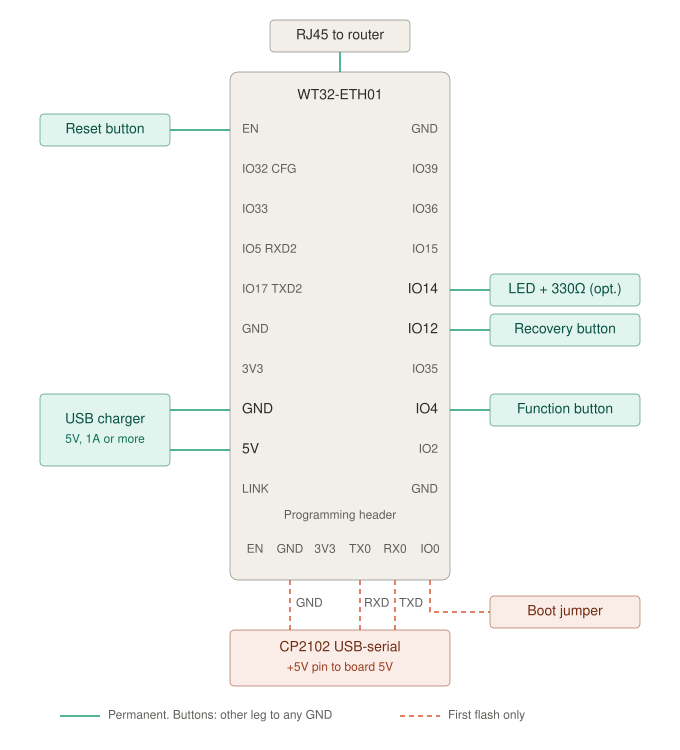

# Wiring and first flash (WT32-ETH01 + Saris H1)

Pin names below match the silkscreen on the WT32-ETH01. The board has a 20-pin
main header (two rows of 10) and a 6-pin programming header at the antenna end
(EN, GND, 3V3, TXD, RXD, IO0). If your board shipped with only the main header
soldered, solder 6 male pins into the programming header, or hold Dupont leads in
place with a rubber band for the one-time flash.

## Permanent connections

| From | To | Notes |
|---|---|---|
| USB charger 5V | `5V` | Any phone charger, 1 A or more. The board has no USB port, so use a USB breakout or a cut cable. |
| USB charger GND | `GND` | Any GND pin. |
| Reset button | `EN` and `GND` | Tap to reboot. |
| Function button | `IO4` and `GND` | Short press: drop and re-pair the trainer. Hold 5 s: reboot. |
| Recovery button | `IO12` and `GND` | Hold while powering on: Wi-Fi access point with the *default* password. Use it if you lock yourself out of the web page. |
| Status LED (optional) | `3V3` → 330 Ω → LED anode, LED cathode → `IO14` | Active low. On while booting, blinks while Wi-Fi connects, off once online. |
| Ethernet | RJ45 jack → your router or switch | Same network as the Zwift PC. |

Tactile switches from the kit have four legs that are joined in pairs. Wire across
diagonal legs and you can't get the pairing wrong.

## First flash only (CP2102)

| CP2102 pin | WT32-ETH01 pin |
|---|---|
| TXD | `RXD` (IO3, programming header) |
| RXD | `TXD` (IO1, programming header) |
| GND | `GND` |
| +5V | `5V` (main header) |

Do **not** power the board from the CP2102's 3V3 pin. That regulator only supplies
about 100 mA, and the ESP32 with the Ethernet PHY and Bluetooth needs more, so you
get random resets or failed flashes. The CP2102's TX/RX lines are 3.3 V logic and
are safe for the ESP32.

Unplug the USB charger lead while the CP2102 is connected. Two 5 V sources on the
same pin can back-feed each other.

The `IO0` pin is also the Ethernet clock input, so it only goes to GND for
flashing. Use a jumper wire, not a permanent button.

### Entering flash mode

The 5-pin CP2102 has no DTR line, so the board can't be reset automatically:

1. Connect `IO0` to `GND` (boot jumper).
2. Tap the reset button (or briefly touch `EN` to `GND`).
3. Remove the boot jumper.
4. Start the upload in PlatformIO.
5. When it finishes, tap reset to start the firmware.

After this first flash, every update goes over Ethernet (see README, "Updating").
