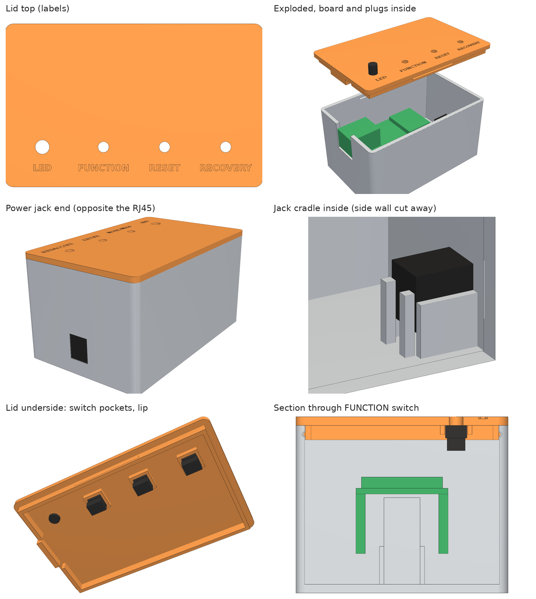

# SHIFTR bridge case (WT32-ETH01, bottom headers)

Outside size with the lid on: **92.8 × 58.8 × 48.8 mm**. Two parts, no screws, no supports.

| File | Use |
|---|---|
| `out/shiftr_case_base.stl` | Print as is: floor on the bed |
| `out/shiftr_case_lid.stl` | Already flipped: top face (with labels) on the bed |
| `out/*_base.step`, `*_lid.step` | Open and edit in FreeCAD or any CAD tool |
| `out/shiftr_case_assembly.step` | Case with simplified board, plugs and switches, for checking fit |
| `shiftr_case.py` | Parametric source (CadQuery). Change a number at the top, run `python shiftr_case.py` |

## What's in it

- **Base**: an RJ45 slot open to the rim so the board drops straight in, and two pillars under the middle of the board. The pillars sit clear of the RJ45 solder pins and both header rows. Under the board there's 25 mm for the Dupont plugs and their wire bends.
- **Power jack**: a window for a DC-005 barrel jack (5.5 × 2.1 mm) in the far end, opposite the RJ45. The jack slides in from inside with its face flush with the outside wall. It sits on a shelf under its front, between two side rails. Two stops behind its corners take the push when you plug in, leaving the middle free for the solder tabs.
- **Lid**: a lip that drops inside the walls, plus snap ridges that click into grooves on the two long walls. A tab closes the RJ45 slot above the jack. Three 6 × 6 mm switch pockets and a 5 mm LED hole sit along one edge, beside the board, so nothing hangs over the RJ45. The labels are engraved 0.6 mm deep: **LED, FUNCTION, RESET, RECOVERY**.

## Printing

PLA or PETG, 0.2 mm layers, 3 walls, 15–20 % infill, no supports.
The lid's labels face the bed, so they print as clean recesses. If you'd like the
letters to stand out, change filament at layer 4 (0.6 mm) or rub in some paint
and wipe off the surface.

If the lid is too tight, set `FIT = 0.25`. If it's too loose, set `SNAP_R = 0.6`.

## Choosing switches from the kit

The switch body is pressed against the underside of the lid (2.4 mm thick), so
the button sticks out by about *switch height − 5.9 mm*:

| Hole | Suggested switch height | Result |
|---|---|---|
| FUNCTION | 8 mm | 2 mm proud, easy to press |
| RESET | 5 mm | about 1 mm recessed: press with a pen, hard to hit by accident |
| RECOVERY | 5 mm | about 1 mm recessed, as above |

Push each switch into its pocket from inside, legs pointing down, then put a dab
of hot glue over the back. The glue takes the force of pressing the button. Solder
or crimp the wires before you glue.

The LED pushes up through its hole from inside; its rim stops it against the
lid. Fix it with a drop of glue. For a 3 mm LED, set `LED_HOLE = 3.1`.

## Assembly

1. Plug the Dupont wires onto the board (the wiring is in `WIRING.md` in the firmware project).
2. Put a 1 mm double-sided foam tape pad on each pillar.
3. Lower the board in with the RJ45 dropping into the end slot, and press it onto the tape.
4. Solder two wires to the barrel jack: centre pin to the board's `5V`, sleeve to `GND`. Leave the third (switch) tab unconnected. Slide the jack into its window from inside until its face is flush with the outside, and fix it with hot glue along the rails.
5. Wire the switches and LED in the lid, route the wires along the side walls, and press the lid on until it clicks.

Leave the wires long enough that the lid can lie open beside the base.

## Assumptions to check before printing

- The board's headers point **down**, as in your "soldered pins" photo. With pins pointing up, the plugs would hit the lid.
- The board measures about 55.5 × 25.5 mm, and the jack is about 16 mm wide and 13.5 mm tall, overhanging the board edge by about 4.5 mm. If your calipers disagree, change `PCB_*` / `RJ_*`.
- The tactile switches are the common 6 × 6 mm type with a round 3.5 mm button.
- The DC-005 jack body is 14.2 mm deep, 9.0 mm wide and 11.0 mm tall, with its solder tabs no more than 4.5 mm below it. These vary a little between makers. Measure yours and set `DC_L`, `DC_W`, `DC_H` and `DC_Z0` if they differ.

## Power: 5 V only

The barrel jack feeds the board's `5V` pin directly, with nothing in between. Use a
**5 V** adapter only; a 9 or 12 V adapter will overheat the board's regulator.
Before connecting the board, check the polarity with a multimeter: plug the adapter
into the jack and confirm that the centre-pin tab reads +5 V against the sleeve tab.
Most adapters are centre-positive, but not all.
